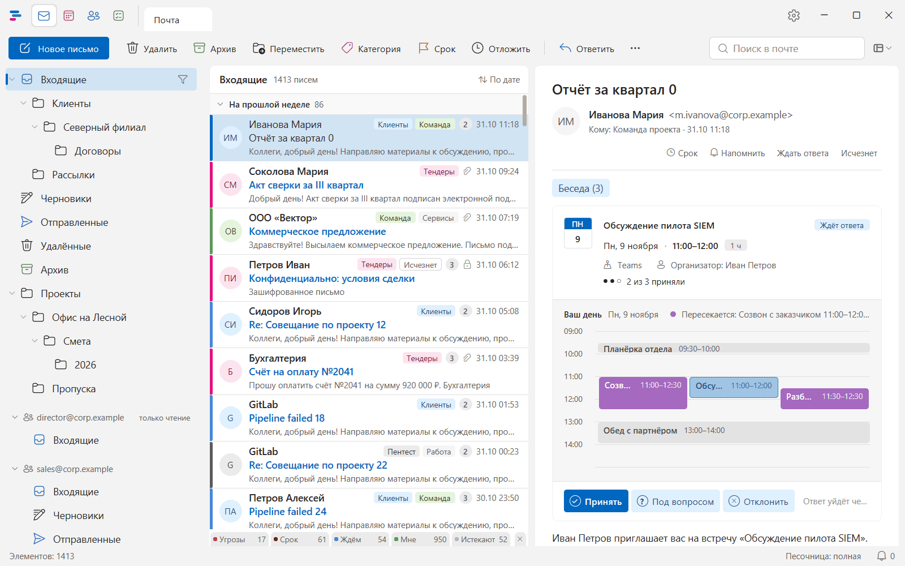
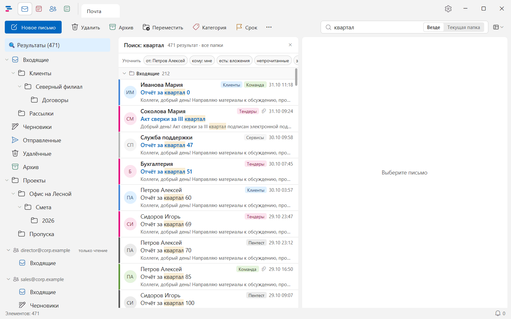
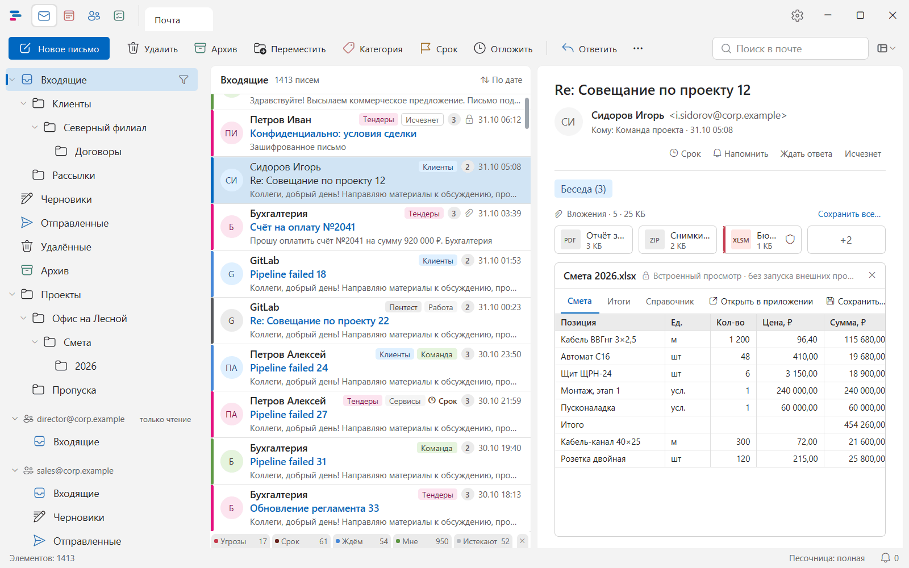
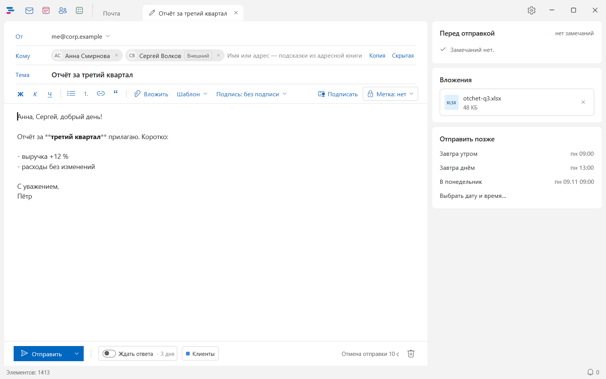
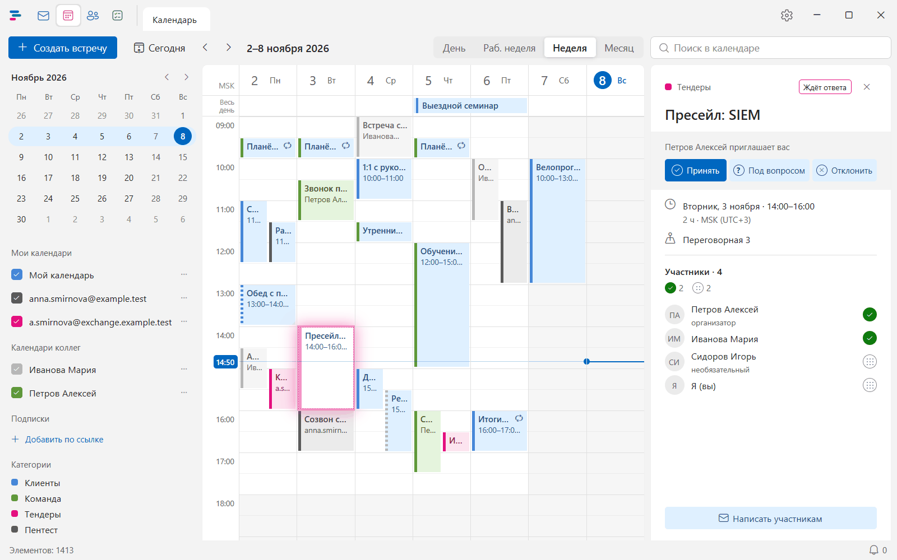
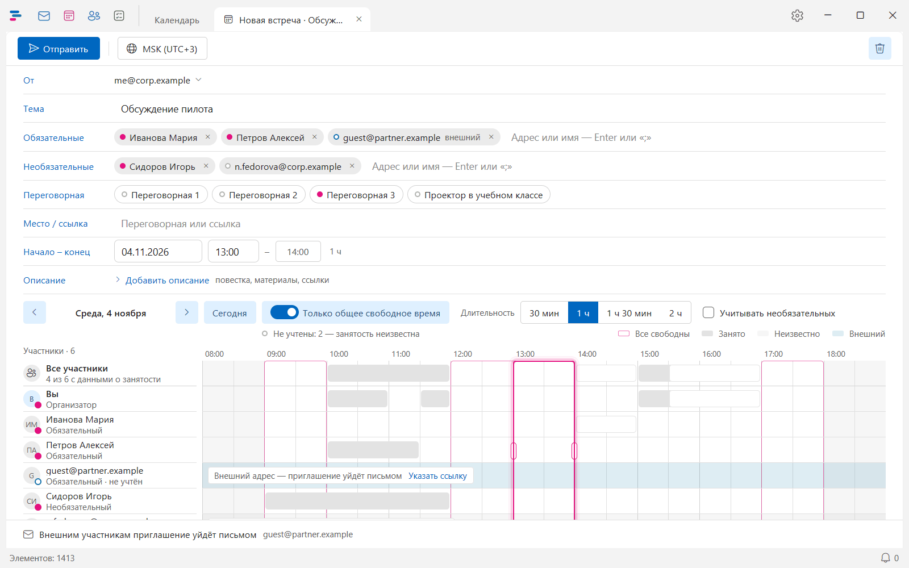

  

<h1 align="center">Postman</h1>

  <b>Почта, календарь и контакты — привычно, как в Outlook, быстро и безопасно.</b>

  <a href="https://github.com/Dicobraz421/Postman/releases"><b>Скачать</b></a> ·
  <a href="docs/USER-GUIDE.md"><b>Инструкция</b></a>

> **Бета-версия.** Основное работает, идёт проверка — возможны шероховатости.

## Что умеет

### Почта как в Outlook, только быстрее

Папки слева, список в середине, письмо справа, те же клавиши. Письма одной беседы собраны вместе, новые отмечены
синей полосой. Десятки тысяч писем листаются без задержек, а загруженное читается и без сети.

- **Сроки и напоминания** — поставьте письму срок, попросите напомнить позже или ждать ответа: Postman сам вернёт
  письмо во «Входящие», когда придёт время.
- **Быстрые фильтры** — непрочитанные, с вложениями, с флагом, «мне», от внешних отправителей — одним щелчком.
- **Палитра команд** (Ctrl+K) — любая команда, папка или письмо по нескольким буквам.
- **Общие ящики** — ящик отдела рядом со своим; письмо можно «взять в работу», чтобы коллеги не ответили параллельно.

### Поиск, который находит

Результаты появляются по мере набора, сразу по всем папкам. Слово найдётся в любой форме, с опечаткой и даже
набранное в другой раскладке (`rdfhnfk` — «квартал»). Уточнить — одним щелчком: от кого, с вложениями, за неделю.

### Вложения без внешних программ

PDF, Word, Excel, PowerPoint, картинки, архивы и вложенные письма открываются прямо в окне — ничего не нужно
скачивать и запускать. Документы с макросами и программы Postman не открывает, а только даёт сохранить.

### Безопасность без лишних вопросов

- Письма и вложения разбираются в **песочнице** — отдельном процессе без доступа к вашим файлам и сети.
- **Внешние картинки — только по вашему выбору**: «Загрузить картинки» в письме или «Всегда для домена» — для
  доверенных отправителей. Без этого отправитель не узнает, что вы открыли письмо.
- **Подменённые ссылки** отмечаются, подозрительное письмо одним щелчком уходит как фишинг.
- **Перед отправкой** Postman заметит забытое вложение, внешних адресатов конфиденциального письма и адресата,
  который сменил адрес.
- **Подпись и шифрование S/MIME**, в том числе ГОСТ (с КриптоПро CSP или ViPNet CSP).

### Новое письмо

Подсказки адресов из контактов, справочника и переписки, адресная книга по щелчку на «Кому…», оформление текста и
таблицы, вставка из Word с таблицами и списками, подпись с логотипом, вложения перетаскиванием, отправка позже и
несколько секунд, чтобы передумать и отменить отправку.

### Календарь и встречи

День, рабочая неделя, неделя и месяц; календари коллег — рядом со своим. Приглашение в письме показано вместе с вашим
днём: видно, с чем пересекается встреча, и ответить можно, не открывая календарь.

Для новой встречи Postman показывает занятость участников и переговорных и подсказывает время, когда свободны все.

### Контакты

Справочник компании, личные контакты, свои группы и «Часто пишу» — с поиском по всем сразу, даже латиницей
(`ivanova`). Письмо группе — одним адресатом.

## С какими серверами работает

- **Stalwart** и другие серверы JMAP;
- **любой сервер IMAP + SMTP** (в том числе Яндекс), календарь и контакты — через CalDAV и CardDAV;
- **Microsoft Exchange** в своей сети (EWS).

Нужны только адрес сервера, логин и пароль — остальное Postman найдёт сам. Для Exchange, если логин в сети компании
не совпадает с адресом почты, — ещё «Имя пользователя» (`ДОМЕН\имя`), как в Outlook.

## Установка

Файлы — на странице [выпусков](https://github.com/Dicobraz421/Postman/releases), выберите свой:

| Файл | Для чего | Когда выбрать |
|---|---|---|
| `postman-…-windows-x64.msi` | Windows 10 и 11, 64 бита | Обычный выбор: Postman появится у всех пользователей компьютера, нужны права администратора |
| `postman-…-windows-x64.zip` | Windows 10 и 11, 64 бита | Прав администратора нет: установка только для себя |
| `postman-…-macos-arm64.dmg` | macOS 13 и новее, Mac с процессором Apple (M1 и новее) | Обычный выбор: перетащите Postman в «Программы» |
| `postman-…-macos-arm64.zip` | То же | То же приложение архивом |
| `postman-…-linux-x64.deb` | Ubuntu 22.04+, Debian 12+ (x86_64), предварительно | `sudo apt install ./postman-….deb` |
| `postman-…-linux-x64.rpm` | Fedora, RHEL (Alma, Rocky) 9, openSUSE (x86_64), предварительно | `sudo dnf install ./postman-….rpm` |
| `postman-…-linux-x64.AppImage` | Любой дистрибутив Linux x86_64, предварительно | Без установки: `chmod +x` и запуск |

Обновляется Postman сам: раз в сутки проверяет новую версию и предлагает установить («Настройки → Общие →
Обновления»); на Linux с пакетами .deb и .rpm — по ссылке «Скачать». Подробнее, удаление и первый запуск на Mac — в [инструкции](docs/USER-GUIDE.md#установка).

## Журнал и диагностика

Что-то пошло не так — причина записана в журнале:

- **Системный журнал** (на Windows): «Просмотр событий» → «Журналы Windows» → «Приложение», источник
  **Postman**. Ошибки записываются как «Ошибка», запасной путь — как «Предупреждение», вехи работы (запуск,
  подключение, синхронизация) — как «Сведения». Коды событий: 1000 — сбой программы, 1001 — ошибка, 1002 — запуск
  невозможен, 1003 — предупреждение, 1004 — сведения.
- **Файл журнала**: `%LOCALAPPDATA%\Postman\logs\postman-ДАТА.log` (на Mac — `~/Library/Logs/Postman`, на Linux —
  `~/.local/state/Postman`), по файлу
  на день, хранится неделю. Подробнее, чем системный журнал: при уровне «Отладка» там же шаги работы с сервером.

Подробность обоих журналов задаётся в «Настройки → Общие → Уровень журнала»: Ошибки, Предупреждения, Сведения (по
умолчанию) или Отладка; действует со следующего запуска. Там же — папка журнала и «Отчёт для поддержки»: архив на
рабочем столе с журналом за неделю, версией и настройками без паролей и адресов. Пароли, токены и тексты писем в
журнал не пишутся никогда.

## Ещё

- [Инструкция пользователя](docs/USER-GUIDE.md) — всё о работе с Postman, все клавиши.
- [Для разработчиков](docs/README.md) — устройство, сборка, выпуск.
- Лицензия — проприетарная, все права защищены: [LICENSE](LICENSE).
